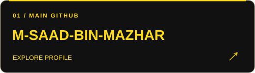
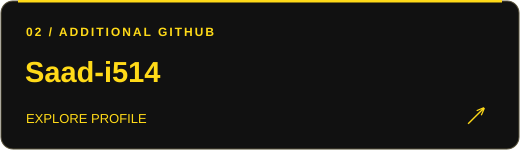
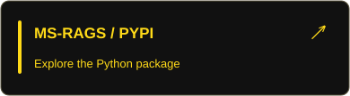
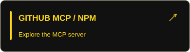
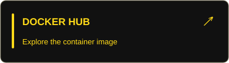

  

  
  
  

<strong>CHOOSE YOUR NEXT STOP</strong> Explore the projects, open the technical details, or jump into my background.

  
  
  
  

## About

I'm **Saad**, an **AI/ML Engineer** and **Founder & Lead Systems Architect at WorkHive HQ**, based in Rawalpindi, Pakistan. I build AI products from the retrieval pipeline and backend architecture to the interface, deployment, and operational workflows.

My work spans **generative AI, RAG, multi-agent systems, full-stack development, system design, and automation**.

| Building | Publishing | Background |
| :--- | :--- | :--- |
| **WorkHive HQ** — a 3D virtual workplace and enterprise ERP | **MS-RAGS**, a RAG framework on PyPI and Docker | **2+ years** of production AI experience |
| AI workflows and automation for **Opatrip.com** | **github-repo-manager-mcp** on npm; **2 NLP models** on Hugging Face | **MIT Hackathon winner, 2026** · NUST Dean's List |

## Selected work

**Click a project banner to explore it. Expand each card for the engineering details.**

<table>
<tr>
<td width="50%" valign="top">

<strong>Founder &amp; Lead Systems Architect</strong>

A 3D virtual workplace with an enterprise ERP: spatial audio, HR recruitment, attendance, payroll, document security, and billing.

<code>React</code> <code>Three.js</code> <code>FastAPI</code> <code>PostgreSQL</code> <code>LiveKit</code>

<strong>Behind the architecture</strong>

The challenge: connect a shared 3D office to real business operations.

Tenant isolation in PostgreSQL; REST and WebSocket services; LiveKit spatial audio; encrypted documents; billing and payroll workflows.

</td>
<td width="50%" valign="top">

<strong>Creator &amp; Maintainer · Open source</strong>

A permission-first CLI that generates a standalone RAG codebase, with configurable retrieval, reranking, vector storage, model providers, and observability.

<code>Python</code> <code>RAG</code> <code>Vector databases</code> <code>Docker</code>

  

<strong>Inside the framework</strong>

The challenge: move from a RAG experiment to an owned, modular codebase.

Configurable retrieval, reranking, provider selection, vector storage, memory, evaluation, and observability. Published on PyPI and Docker.

</td>
</tr>
<tr>
<td valign="top">

<strong>MIT Hackathon winner · 2026</strong>

A browser-level AI SDK and Chrome extension with MCP integration. Six agents coordinate planning, navigation, extraction, execution, memory, and voice.

<code>JavaScript</code> <code>Node.js</code> <code>MCP</code> <code>Multi-agent systems</code>

<strong>Meet the six agents</strong>

The challenge: translate intent into coordinated browser actions.

Planning → navigation → extraction → execution, with memory and voice capabilities. MCP connects the SDK to tools; a Chrome extension supports DOM automation.

</td>
<td valign="top">

<strong>Full-stack AI · Academic automation</strong>

A multi-agent platform for generating lab reports, executing MATLAB code, creating diagrams, and exporting DOCX documents.

<code>Next.js</code> <code>FastAPI</code> <code>CrewAI</code> <code>PostgreSQL</code>

 

<strong>Follow the workflow</strong>

The challenge: coordinate report generation and code execution in one product.

Lab inputs → agent coordination → MATLAB execution → generated diagrams and report sections → DOCX export.

</td>
</tr>
</table>

<strong>Explore more: developer tools, voice AI, automation &amp; healthcare</strong>

| Project | What I built | Technologies |
| :--- | :--- | :--- |
|   | MCP server connecting AI assistants to GitHub repository operations | TypeScript, Node.js, MCP, GitHub API |
|  | Seven coordinated workflows for candidate matching, enrichment, CRM integration, and WhatsApp routing | n8n, OpenAI, HubSpot, FastAPI, React |
|  | Streaming conversational agent with vector memory, voice activity detection, and interruption handling | Python, asyncio, FAISS, Silero VAD |
|  | Multi-tenant inventory and business management with RBAC and real-time SSE updates | FastAPI, PostgreSQL, SQLAlchemy, React, AWS |
|  | Pneumonia classification, health-risk prediction, and a retrieval-based medical chatbot | TensorFlow, XGBoost, RAG, FastAPI, React |
|  | Connected workflows for document generation and business processes | n8n, Python, APIs |

## System design

**System design is part of how I build products:** defining service boundaries, modeling data, coordinating real-time events, and making deployment and operations part of the design.

| Area | My toolkit & practical focus |
| :--- | :--- |
| **Application architecture** | Modular backend design, multi-tenant SaaS, REST APIs, database modeling, separation of concerns |
| **Real-time systems** | WebSockets, SSE, WebRTC, spatial audio, concurrent workflows, shared-resource coordination |
| **Messaging & asynchronous work** | **Apache Kafka**, event-driven architecture, Redis, Celery, background processing, webhooks |
| **Cloud & orchestration** | **Kubernetes (K8s)**, Docker, CI/CD, GitHub Actions, AWS EC2, S3, SageMaker |
| **Security & access** | Tenant isolation, RBAC, JWT, OAuth 2.0, rate limiting, API key management, client-side encryption |
| **AI system quality** | Retrieval evaluation, reranking, model experimentation, tracing, observability, latency and cost tradeoffs |

<strong>Architecture in practice: WorkHive HQ</strong>

- **Product surface:** React and Three.js provide a navigable 3D office alongside enterprise workflows.
- **Backend:** FastAPI exposes modular REST and WebSocket endpoints backed by PostgreSQL tenant isolation.
- **Coordination:** Desk-claim locking and WebSocket updates coordinate shared workplace resources.
- **Communication:** LiveKit SFU WebRTC supports spatial proximity audio.
- **Security:** Client-side AES-256-GCM encryption protects documents.
- **Operations:** Paddle billing webhooks, corporate trial provisioning, recruitment pipelines, and dual-authorization payroll connect the product to business processes.

 

## Technical toolkit

Choose a discipline to open its toolkit.

<strong>AI & MACHINE LEARNING</strong>

| Discipline | Technologies |
| :--- | :--- |
| **Generative AI & agents** | RAG, LangChain, LangGraph, CrewAI, AutoGen, MCP, OpenAI API, Claude API, embeddings, prompt engineering, LoRA / QLoRA |
| **Machine learning** | PyTorch, TensorFlow, Keras, scikit-learn, XGBoost, OpenCV, Hugging Face Transformers, NLP, computer vision |
| **Data & evaluation** | Pandas, NumPy, Matplotlib, Seaborn, Plotly, feature engineering, RAGAS, DeepEval, LangSmith, Langfuse, OpenTelemetry |

<strong>APPLICATIONS & DATA</strong>

| Discipline | Technologies |
| :--- | :--- |
| **Backend & languages** | Python, JavaScript, TypeScript, SQL, C++, Java, FastAPI, Django, Flask, Node.js, Express.js, NestJS |
| **Frontend & 3D** | React, Next.js, Three.js, React Three Fiber, HTML, CSS |
| **Databases & retrieval** | PostgreSQL, MySQL, MongoDB, Redis, FAISS, Pinecone, Qdrant, ChromaDB, Weaviate, Milvus, Elasticsearch |

<strong>CLOUD, KUBERNETES & AUTOMATION</strong>

| Discipline | Technologies |
| :--- | :--- |
| **Infrastructure & MLOps** | Kubernetes, Docker, Apache Kafka, AWS, Linux, CI/CD, GitHub Actions, MLflow, DagsHub, Railway, Render, Vercel |
| **Automation & integrations** | n8n, Make, Vapi, HubSpot, WhatsApp API, Hunter.io, Apollo.io, Celery, webhooks |

## Experience

| Role | Organization | Period |
| :--- | :--- | :--- |
| **Founder & Lead Systems Architect** | WorkHive HQ | 2025–Present |
| **AI Automation Specialist** · Freelance, remote | Opatrip.com | Jul 2026–Present |
| **Freelance AI/ML Engineer** | Independent clients | Jan 2024–Present |
| **AI/ML Engineering Intern** | Elevvo Pathways | Aug–Sep 2025 |
| **AI/ML Engineering Intern** | Innoverse.pk | Aug–Sep 2025 |

<strong>More about my experience &amp; certifications</strong>

**WorkHive HQ:** Founded and architected a 3D virtual workplace and enterprise ERP, bringing together real-time communication, multi-tenant backend services, security, and business operations.

**Opatrip.com:** Build and maintain AI-powered operational workflows, connecting tools and business logic to reduce repetitive manual work.

**Independent clients:** Built and deployed 10+ RAG pipelines and agentic workflows, published fine-tuned NLP models and developer tools, and delivered streaming voice agents and cloud-hosted APIs.

**Internships:** Worked on classification, clustering, predictive modeling, CNN traffic-sign recognition, and a deployed depression-prediction project.

**Certifications:** Advanced RAG with Vector Databases (IBM/Coursera); ChatGPT Prompt Engineering for Developers (DeepLearning.AI); Introduction to Generative AI (AWS); Data Science & AI Advanced (Udemy).

## Find my work

**Two GitHub accounts. One place to explore my work.** Choose a profile, browse its repositories, or view its contributions.

   
  
  

   
  
  

### Published work

Explore the models, packages, and tools I publish.

  
  
  
  

---

Open to AI/ML engineering roles, product development, automation consulting, and open-source collaboration.

   
  
  

Rawalpindi, Pakistan

